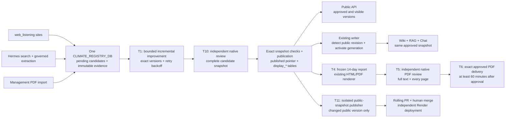
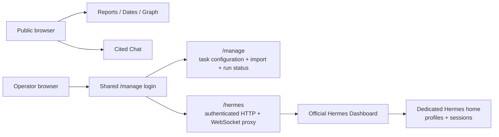

# Climate Monitor Wiki

A climate-risk, natural-catastrophe insurance and actuarial knowledge base with
reviewed articles, events, cited chat and PDF reports.

Website acquisition, search and PDF imports share one external Registry.
Approved content feeds the public API, Wiki, Chat and reports; report generation
is independent of knowledge updates. This overview describes the current code.
Installed jobs and production readiness require separate
[deployment verification](docs/biweekly-et-deployment.md#independent-task-cutover).

## Features

| Surface | Purpose |
|---|---|
| **Chat** (default) | Cited answers in Brief, Detailed and Report modes; explicit requests can create an on-demand PDF |
| **Reports** | Historical reports, PDFs, article search and source evidence |
| **Dates** | Upcoming meetings, deadlines and participation information |
| **Graph** | Wiki page index, note details and Notes / Keywords graphs |
| **Management** (`/manage`) | Authenticated task configuration, acquisition, PDF import, progress and resume |
| **Hermes** (`/hermes`) | Optional official Hermes Dashboard using the same management login |

The [Obsidian plugin](.obsidian/plugins/climate-agent-chat/) uses the same API
and can prioritize the active note. See [UI surfaces](docs/ui-surfaces.md).

Chat supports OpenAI, Claude and source-only answers. With a configured model,
it can research approved knowledge and read current web evidence through
governed tools. Conversation web evidence stays in that chat; it does not update
the Registry. On-demand PDFs are separate from formally reviewed report delivery.
See the [research operating manual](agentic_wiki/chat_instructions.md).

<a id="modular-weekly-monitor"></a>

## Pipeline

URL-backed articles use a canonical URL identity. Website, search and PDF
evidence share one Registry.

<a id="new-flow"></a>

### Data flow



Automated candidates pass T1 improvement, independent T10 review and final
checks bound to the complete candidate snapshot. The
[owner review route](docs/owner-agent-verification.md) records its own evidence
and approval. Pending updates preserve the previous approved version;
`is_visible` controls public visibility across all sources.

The existing intake writer activates Wiki/Chat from the same approved snapshot.
A failed activation retains the previous generation. T11 exports approved public
data to a rolling PR independently of report dates; human merge and deployment
remain separate steps. Render serves the committed public JSON/Wiki snapshot
without needing the production database.

The current scheduling target is `independent-et`: eleven Hermes jobs plus the
existing PDF intake writer. It separates five-minute incremental improvement,
daily five-site rotation, weekly search, biweekly report generation, native
review, delayed delivery and public snapshot publication. Exact timings and
cutover gates belong in [pipeline configuration](PIPELINE_CONFIG.md#independent-task-profile).
The older four-slot sequence remains for compatibility.

### Operations access



Management requires `CLIMATE_CONSOLE_USERNAME`,
`CLIMATE_CONSOLE_PASSWORD_HASH` and `CLIMATE_CONSOLE_SESSION_SECRET`.
The Dashboard is opt-in with `HERMES_DASHBOARD_ENABLED=1` and an explicit
`CLIMATE_PUBLIC_ORIGIN`. Follow the [deployment guide](docs/deployment.md)
for credentials, persistent storage and runtime setup.

### Modules and data

| Path | Responsibility |
|---|---|
| `climate_monitor/` | Governed acquisition, PDF intake, evidence, task configuration and serial authoring |
| `climate_registry/` | Article/event identity, candidates, review, publication and approved projections |
| `climate_delivery/` | Report rendering, immutable PDF revisions, review and exact-file email delivery |
| `agentic_wiki/` | Retrieval, cited answers and bounded research tools |
| `api_server.py`, `showcase/`, `management_ui/` | API, public workspace and authenticated management |
| `monitoring/` | Source scopes, taxonomy and task bootstrap prompts |
| `scripts/`, `tests/` | Operational entrypoints and automated checks |
| `sources/` | Immutable report archives and citation evidence |
| `wiki/` | Generated pages, report index and approved Git snapshot |

`CLIMATE_REGISTRY_DB` selects the external business database; runtime storage
holds queues, task state and derived artifacts. API database connections are
read-only. Saved `/manage` tasks own the five business prompts; runs freeze their
versions and hashes. See [configuration ownership](PIPELINE_CONFIG.md#configuration-ownership).

## Quick start

Use Python 3.12 for the application. From the repository root:

```bash
python -m venv .venv
source .venv/bin/activate
pip install -r requirements.txt
cp .env.example .env
python -m scripts.run_render_web
```

On Windows, activate with `.venv\Scripts\Activate.ps1`.
Open [localhost:8501](http://localhost:8501), or forward port 8501 in Codespaces.
The startup entrypoint builds a temporary Registry from archived reports and
the committed approved snapshot. With `CLIMATE_REGISTRY_DB` set, it uses that
database instead.

Optional Chat settings in the local environment:

- **OpenAI:** `OPENAI_API_KEY` and `OPENAI_MODEL`.
- **Claude:** `ANTHROPIC_API_KEY` and `ANTHROPIC_MODEL`; select
  `CLIMATE_CHAT_PROVIDER=anthropic` when both providers are configured.
- **Source-only:** no model key; returns available approved facts and cited extracts.

Keep real credentials out of Git. Use [.env.example](.env.example) as the
configuration template. The main API routes are `GET /api/health`,
`GET /api/config`, `POST /api/chat` and the protected `POST /api/reload`.

## Deployment and content updates

- **Docker + Caddy:** use the [deployment guide](docs/deployment.md) for the
  shared Registry, existing writer, runtime storage and upgrade checks.
- **Render:** [render.yaml](render.yaml) defines the build, startup and health
  check. It serves the approved Git snapshot; add model credentials in Render
  separately if needed.
- **Website, search and PDF intake:** use the
  [managed intake workflow](docs/deployment.md#explicit-management-pdf-imports).
  Intake completion alone does not approve or activate content.
- **Historical reports:** preserve existing `sources/` and PDF bytes. The
  [source update SOP](docs/source-update-sop.md) covers archive ingestion and
  local regeneration. [wiki/index.md](wiki/index.md) lists archived reports;
  weekly rendering creates pages only for real report dates.

Hermes owns scheduled generation. GitHub hosts code and reviewed public
snapshots; it does not run a competing report generator.

## Checks

```bash
python -m pytest -q
node --check showcase/app.js
```

See [testing](docs/testing.md) for UI and runtime checks. Repository tests,
isolated source rehearsals and a full production cycle are separate evidence.

## Documentation

| Reference | Contents |
|---|---|
| [Architecture](docs/article-first-architecture.md) | Shared Registry, review, public projections and report boundaries |
| [Pipeline reference](PIPELINE_REFERENCE.md) | Programs, artifact contracts, resume and verification |
| [Pipeline configuration](PIPELINE_CONFIG.md) | Saved prompts, source scopes, taxonomy and independent jobs |
| [Deployment and cutover](docs/biweekly-et-deployment.md) | Runtime wiring, no-send rehearsal and live acceptance |
| [Registry](docs/article-registry.md) | Evidence, identity, dates, migrations and backups |
| [Publication acceptance](docs/publication-acceptance.md) | Read-only checks of approved content, API, Wiki, RAG and Chat |
